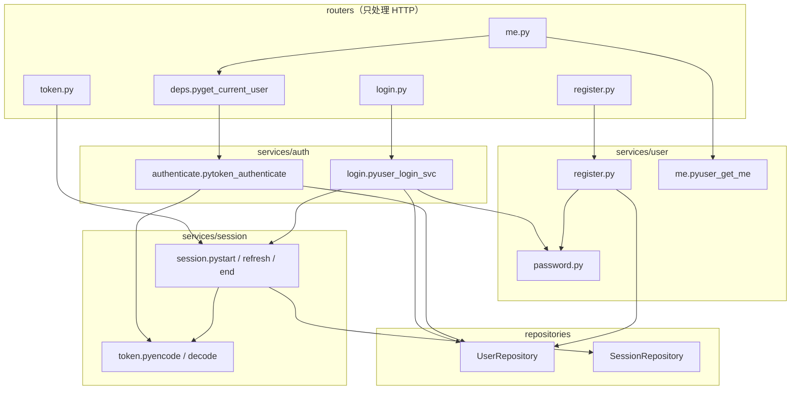
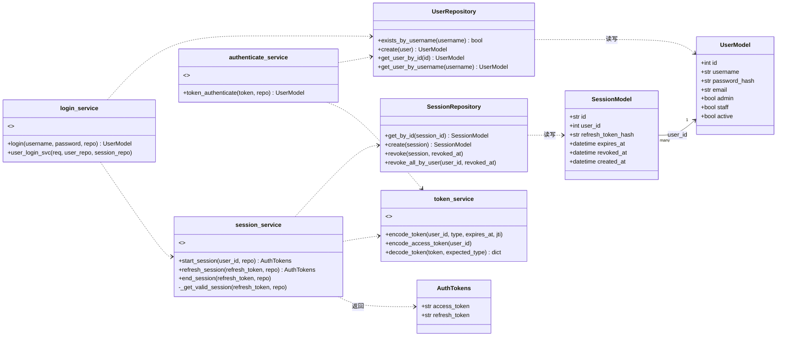
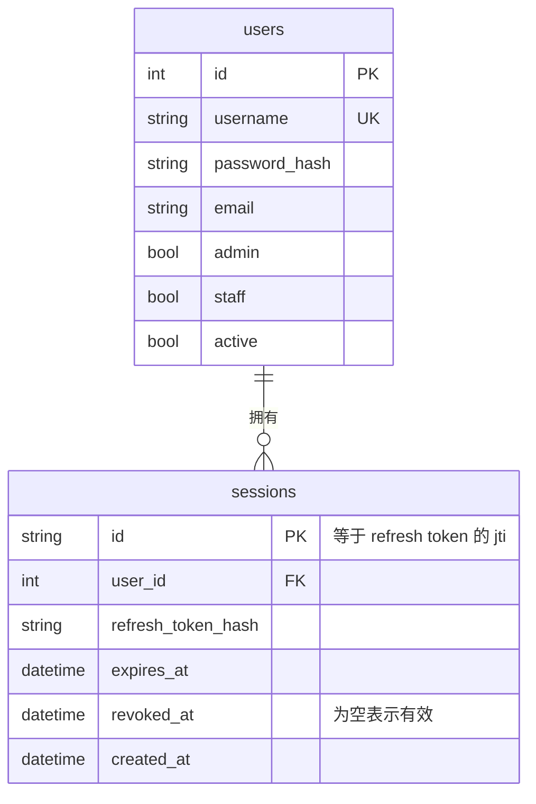
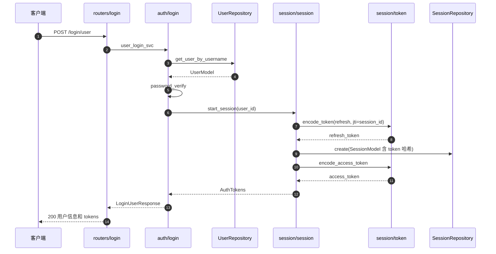
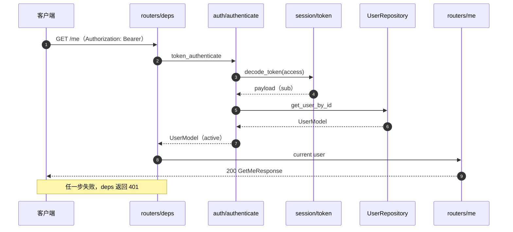
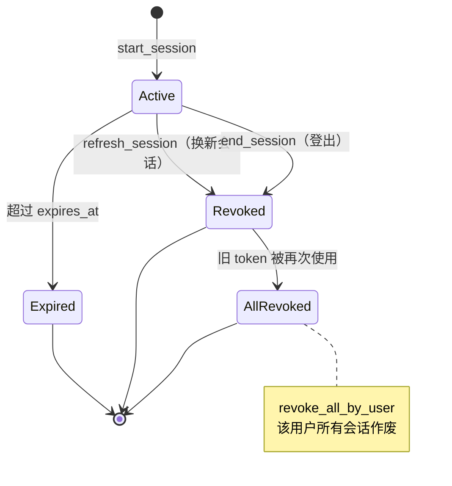

# Simulation Project UML

用户、会话、认证三个领域的结构图。当前代码快照：src/ 下 services、repositories、models、schemas、routers 五层。

[依赖方向](#deps)[类与模块](#class)[数据表](#er) [登录流程](#login)[带 token 请求](#request)[刷新与登出](#refresh)[接口](#routes)

usersessionauth

## 依赖方向

auth 同时依赖 user 和 session；user 与 session 互不依赖。箭头表示“使用”。

## 类与模块

函数式的 service 用 module 构造型表示，Repository 和 Model 是真正的类。

## 数据表

一个用户可以有多条会话，每条会话对应一台设备的一次登录。refresh token 里的 jti 等于 sessions.id。

## 登录流程

密码验证在 user 一侧，建会话和签发 token 在 session 一侧，auth 把两步接起来。

## 带 token 的请求

只验证 access token 的签名和过期时间，不查 sessions 表，所以每次请求只有一次用户查询。

## 刷新与登出

每个 refresh token 只能用一次。已作废的 token 再次出现，说明可能被盗，该用户的全部会话一并撤销。

## 接口

main.py 目前只注册了 register 和 login，me 与 token 两个 router 还没有加进去。

| 方法 | 路径 | Router | Service | 已注册 |
| --- | --- | --- | --- | --- |
| POST | `/register/user` | register.py | user | 是 |
| POST | `/register/staff` | register.py | user | 是 |
| POST | `/register/admin` | register.py | user | 是 |
| POST | `/login/user` | login.py | auth | 是 |
| GET | `/me` | me.py | user + auth | 否 |
| POST | `/token/refresh` | token.py | session | 否 |
| POST | `/token/logout` | token.py | session | 否 |